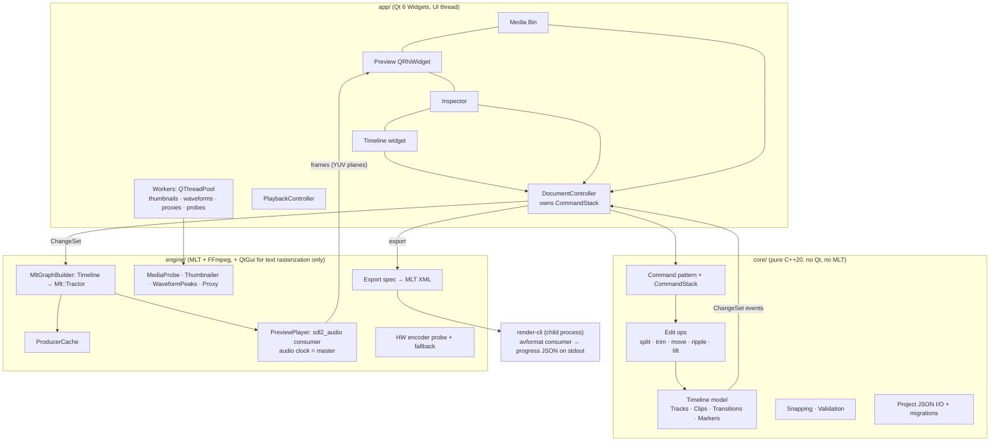

# Cutline: project plan

Cutline is a lightweight, cross-platform (Windows, Linux, macOS) non-linear editor for video,
audio and images. The goal is a small set of basic features done really well: a multi-track
timeline, cutting and trimming, background music, smooth real-time preview, and reliable export.

This is the plan agreed before implementation started. Conventions for working in the code
are in [`CLAUDE.md`](../CLAUDE.md), and bundled dependencies are listed in
[`THIRD_PARTY.md`](THIRD_PARTY.md).

## Status

| Phase | Scope | Status |
|---|---|---|
| 0 | Skeleton, CI, empty panel layout | ✅ Done, in review |
| 1 | Import, media bin, single-clip preview | Next |
| 2 | Timeline UI: drag, drop, move, snap, zoom | |
| 3 | Split, trim, delete, ripple, undo/redo | |
| 4 | Multi-track compositing preview, audio mixing, waveforms | |
| 5 | Export pipeline, presets, HW encoding | |
| 6 | Transform, text, transitions, speed, color | |
| 7 | Image editing mode | |
| 8 | Save/load, autosave, relink, shortcuts, installers | |

## Decisions

| Topic | Decision |
|---|---|
| Stack | **C++20 + Qt 6 (Widgets) + MLT 7 + FFmpeg**, the Shotcut/Kdenlive architecture (see below) |
| Qt version | Qt **6.12 LTS** for CI and release builds. Phase 0 builds with Qt ≥ 6.4; Phase 1 raises the minimum to 6.7 for `QRhiWidget` |
| Dependency licenses | **LGPL-only.** Nothing GPL is bundled: no x264/x265, no MLT `qt6`/`plusgpl`/`rubberband`/`vidstab`, no frei0r, no movit. Cutline's own license is still open (no `LICENSE` file yet) |
| Repository layout | Editor at the root of `yasirfaizahmed/tooling` |
| Name | **Cutline**. Namespace `cutline::`, project files `*.cutline` (JSON), bundle ID `io.github.yasirfaizahmed.cutline` |
| Platforms | Windows 10/11 x64; macOS 13+ on Apple Silicon (arm64 only); Linux x86_64 built on Ubuntu 22.04 (glibc 2.35 baseline) |
| Project defaults | 1920×1080 @ 30 fps, 48 kHz stereo; "match first clip" is offered on the first drop |
| Signing | Unsigned builds for now. macOS notarization needs an Apple Developer account and Windows signing needs a certificate; both get documented in Phase 8 |

## 1. Stack evaluation

The deciding factor is **real-time multi-track compositing with sample-accurate A/V sync**,
which is the hardest part of an NLE. What matters is whether a stack gives us that or makes us
write it.

| | A) Tauri 2 + React + FFmpeg | B) Python + PySide6 + MLT/PyAV | **C) C++ + Qt 6 + MLT** ✅ |
|---|---|---|---|
| **Preview performance** | Weakest. Decoded frames live in Rust but the UI is a WebView. We'd have to push ~250 MB/s of RGBA through IPC, or put a native GPU surface under a transparent WebView on each OS (unsupported, and fragile on WebKitGTK). WebCodecs support is inconsistent across WebViews. A/V sync would be built by hand | With PyAV we write the compositor, mixer, A/V clock and transitions in Python, under the GIL. With MLT the engine is fine, but its SWIG bindings aren't on PyPI for Windows or macOS | Best. MLT already does compositing, mixing, A/V-clocked playback, transitions, speed, preview scaling, proxies and avformat export with HW encoders, and it's proven in Shotcut and Kdenlive. Frames go straight into a native GPU widget (QRhi: D3D11/Metal/Vulkan/GL) |
| **Packaging** | Bundler is excellent, but FFmpeg linking into Rust on 3 OSes is still on us | Worst: frozen Python + Qt plugins + MLT modules + FFmpeg, plus signing and notarization of a frozen app | Medium-high. We build FFmpeg and MLT per OS once in CI (vcpkg + binary cache). Shotcut proves the full matrix works |
| **Development speed** | Fastest UI, slowest engine (months of work that MLT already does) | Fastest to prototype; slows sharply with performance and packaging | Medium. More verbose UI code, but the engine is mostly integration |
| **Maintainability** | Good language, but we'd own a home-grown media engine forever | Familiar language, but the NLE hot path in Python is a known pain point | Proven architecture, actively maintained LGPL engine, integer-frame time model |

Also considered: **GStreamer + GES** (rocky frame-accurate seeking history, and outside the
"FFmpeg-based" constraint) and **hybrid Python/Web UI over a C++ core** (two build systems plus
an FFI layer on the hot path). Both were rejected.

Inside Qt, the UI uses **Qt Widgets** for panels, menus, dialogs and the inspector, and a
**custom-painted `QWidget` timeline** (one language, testable in C++). The preview is a
**`QRhiWidget`** that converts YUV to RGB in a shader.

## 2. Licensing

MLT's `-DGPL=OFF` force-disables qt6, plusgpl, rubberband, vidstab, resample, normalize, openfx
and xine. FFmpeg's LGPL build excludes libx264 and libx265.

- **FFmpeg**: `--disable-gpl --disable-nonfree --enable-shared` with openh264 (BSD), libvpx,
  opus, lame, dav1d, plus the HW encoder interfaces (nv-codec-headers, libvpl/QSV, VAAPI, AMF,
  VideoToolbox, MediaFoundation).
- **MLT modules**: core, avformat (which exposes FFmpeg `avfilter.*` as MLT filters), plus
  (`affine` compositing), xml, sdl2 audio.
- **Written in-house to stay LGPL-clean**: a small MLT title producer that renders text with
  QPainter. Color uses `avfilter.eq`, flips use `avfilter.hflip`/`vflip`, and pitch-preserving
  speed uses `avfilter.atempo`.
- **Software H.264 fallback** is OpenH264, whose quality is below x264. That only matters
  without a HW encoder: Windows always has `h264_mf` and macOS always has VideoToolbox, so it's
  mostly GPU-less Linux.
- **Qt** is LGPLv3 and dynamically linked.
- **Escape hatch**: moving to GPL-3.0 later is a build-flag change (x264, MLT qt6, rubberband,
  frei0r). The architecture doesn't change.

## 3. Architecture



- `core` links only the C++ standard library (plus a JSON library once project I/O lands).
- `engine` never includes Qt Widgets; `app` is the only layer that knows about widgets.
- All model changes go through `Command` objects on the `CommandStack`. A drag shows a ghost and
  commits **one** command on release.
- Long work (probing, thumbnails, waveform peaks, proxies, export) never runs on the UI thread.
  Export runs in a **separate process** (`render-cli`), so an encoder or driver crash can't take
  down the editor, and cancelling means terminating the child.
- A model change produces a ChangeSet. The preview then rebuilds only the affected MLT
  playlists, reusing cached parent producers so files aren't reopened.

### Folder structure

```
CMakeLists.txt  CMakePresets.json  vcpkg.json
cmake/                    # warnings and other CMake helpers
vcpkg-ports/mlt/          # overlay port, LGPL configuration                 (Phase 1)
src/core/                 # cutline_core: model, time, ids, validation (pure C++)
  include/cutline/core/
  src/
src/engine/               # cutline_engine: MLT/FFmpeg integration          (Phase 1+)
src/render_cli/           # headless exporter process                       (Phase 5)
src/app/                  # Qt UI: main_window, theme/, panels/{media_bin,preview,inspector,timeline}/
tests/{core,engine,app,integration}/
packaging/{windows,linux,macos}/                                              (Phase 8)
docs/{PLAN.md,THIRD_PARTY.md}
.github/workflows/ci.yml
CLAUDE.md  README.md
```

## 4. Timeline data model (`core`)

**Time.** `Rational {int64 num, den}` is always normalized and overflow-checked. The project frame
rate is a `Rational` (e.g. `30000/1001`). **Timeline positions and durations are `int64` frame
indices at the project rate**, which map 1:1 onto MLT positions, so there's no floating-point
time anywhere. Source offsets are **exact rational seconds** (`RationalTime`), so a 24 fps clip
on a 29.97 fps timeline splits exactly. Time→frame conversion has one canonical rule:
`frameAt(t) = floor(t × fps)`, the frame on screen at instant `t`. Audio sample positions use
`firstSampleOfFrame(n) = floor(n × sampleRate / fps)`, which gives the drift-free 1601/1602
sample pattern at 29.97 fps.

```cpp
struct MediaAsset { MediaId id; std::string path; Fingerprint fingerprint;  // size + head/tail hash → relink
                    MediaKind kind; RationalTime duration; Rational frameRate;
                    int width, height; bool hasVideo, hasAudio, isVariableFrameRate;
                    int sampleRate, channels; std::optional<std::string> proxyPath; };

struct Clip { ClipId id; MediaId media;
              FrameIndex start, length;          // timeline position/duration
              RationalTime sourceIn;             // exact offset into the source
              Rational speed{1};                 // 1/4 … 4
              std::optional<LinkId> link;        // A/V pair from one file moves/trims/splits together
              bool enabled;
              AudioProps audio;   // gainDb, muted, fadeIn/fadeOut (frames)
              VideoProps video;   // Transform{pos, scale, rotation, flips}, Crop, opacity,
                                  // ColorAdjust{brightness, contrast, saturation}, fadeIn/fadeOut
              std::vector<Effect> effects; };    // generic {type, params} for future effects

struct Track { TrackId id; TrackKind kind; std::string name;
               bool muted, solo, locked, hidden; double gainDb;
               std::vector<Clip> clips; };       // sorted by start, never overlapping

struct Transition { TransitionId id; TrackId track; ClipId left, right;   // adjacent at a cut
                    FrameIndex length; TransitionAlignment alignment;
                    TransitionKind kind; };      // CrossDissolve | DipToBlack; uses source handles

struct Timeline { Rational frameRate; Resolution resolution; int sampleRate; ChannelLayout layout;
                  std::vector<Track> videoTracks;   // [0] = V1 (bottom); higher index draws on top
                  std::vector<Track> audioTracks;
                  std::vector<Transition> transitions; std::vector<Marker> markers; };
```

- **Future-proofing.** Visual parameters are `Param<double>`. They're constant today, and keyframes
  can be added later without a schema break. Positions and crops are fractions of the canvas or
  source, so they're independent of resolution and proxies.
- **Edit operations** are pure functions returning `Result<ChangeSet>`: `insert`/`overwrite` (drop),
  `move` (across tracks, overwrite semantics, links respected), `split` (selected clips or all
  unlocked tracks at the playhead), `trimIn`/`trimOut` (clamped to media handles, neighbours and a
  minimum of 1 frame; images unbounded), `lift`, `rippleDelete` (optionally across all unlocked
  tracks to keep sync), `setProps`, add/remove track and transition, `unlink`.
- **Undo.** Each command snapshots the affected tracks and transitions before and after, so undo
  is exact even for a multi-track ripple. Property commands merge within one gesture.
- **Validation.** `validate(Timeline)` checks every invariant. Tests run it after every
  operation, plus a randomized test where undo-all must restore the original and redo-all must
  restore the final state.
- **Snapping** is a pure function over snap points (playhead, clip edges, markers) with a
  tolerance in frames that the UI derives from the zoom level.
- **The project file** is JSON with a `schemaVersion`. Media is referenced by path + fingerprint,
  and migrations live in `project_io`.

## 5. Milestones

Estimates are focused working days, including integration and debugging on three OSes.

| Phase | Scope | Est. | Exit check |
|---|---|---|---|
| **0** | CMake + vcpkg skeleton; `core` types (Rational, RationalTime, typed IDs, model structs, validation, timecode) + Catch2 tests; Qt Widgets main window with the four panels, dark theme, HiDPI, layout save/restore/reset; offscreen Qt Test smoke test; CI on Linux/Windows/macOS producing downloadable app archives | 1–2 | CI green on all 3; the window opens with the layout |
| **1** | Dependency pipeline (FFmpeg LGPL + MLT overlay port via vcpkg, CI cache), bundle-relative MLT init; import (dialog + OS drag), MediaProbe, background thumbnails, media bin (grid/list, duration, codec, resolution), single-clip preview with audio (play/pause, scrub, ←/→) | 5–7 | Import an MP4/MP3/PNG on each OS and play it with sound |
| **2** | Timeline widget: ruler, track headers, add/remove tracks, drop from bin (linked A/V), move within and between tracks, snapping toggle (N), zoom (Ctrl+wheel, +/−), scrolling, playhead, hover/selection/drop-target feedback | 5–6 | Arrange 5+ clips across tracks smoothly at 4K and at 1366×768 |
| **3** | Split (S, Ctrl/Cmd+B), trim handles, lift (Del), ripple delete (Shift+Del), linked selection, undo/redo for every operation; full core test suite + randomized undo/redo test | 3–4 | Every operation undoable; tests green |
| **4** | Model → MLT tractor builder; layered compositing preview; audio mixing, per-clip/per-track volume, mute, solo, fade handles, cached multi-resolution waveforms; J/K/L shuttle; preview scaling; VFR detection with optional CFR proxy | 6–8 | 3 video layers + 2 audio tracks play in sync without drift |
| **5** | Export dialog + presets (1080p/720p/4K; MP4 H.264+AAC default, MOV, WebM), render-cli child process, progress + cancel, HW encoder probing (NVENC/QSV/AMF/MF/VideoToolbox/VAAPI) with fallback, audio-only export (MP3/WAV), extract audio. **Integration test**: timeline → export → `ffprobe` asserts codec, size, fps, duration, A/V length within 1 frame | 4–6 | Export plays in VLC; integration test green in CI |
| **6** | Inspector: transform, crop, speed 0.25–4× (atempo), cross-dissolve / dip-to-black, title producer (font, size, color, position, duration), brightness/contrast/saturation, video fades | 6–8 | Each property is visible in preview and in the export |
| **7** | Image editing workspace: crop, resize, rotate, flip, B/C/S as a non-destructive op stack; export JPG/PNG/WebP | 2–3 | Edit and export each format |
| **8** | Save/load, autosave + crash recovery, missing-media relink, full shortcut map, light theme, polish; installers: NSIS `.exe`, AppImage + `.deb`, `.dmg`; release workflow on tags | 6–9 | The MVP scenario passes from installers on all 3 OSes |

**Total ≈ 38–53 focused days.** Phases 1 (dependency pipeline) and 4 (engine integration) carry
the most risk.

### Key risks

1. **MLT under MSVC/vcpkg.** MLT's CMake supports MSVC (PThreads4W, dirent, dlfcn-win32).
   Fallback: the MSYS2 UCRT64 toolchain that Shotcut uses.
2. **Variable-frame-rate phone footage** causing drift. Mitigation: detect it on import and offer a
   CFR proxy.
3. **4K long-GOP HEVC scrubbing.** Mitigation: preview scaling and proxies.
4. **OpenH264 quality on GPU-less Linux** (a consequence of the LGPL-only policy).

## Definition of done (MVP)

On Windows, Linux and macOS: import a video, a music track and a few images; arrange them on
multiple layers; cut and trim them; put music under the video with a fade out; add a title; and
export a 1080p MP4 that plays correctly in VLC. No crashes, no A/V drift.
